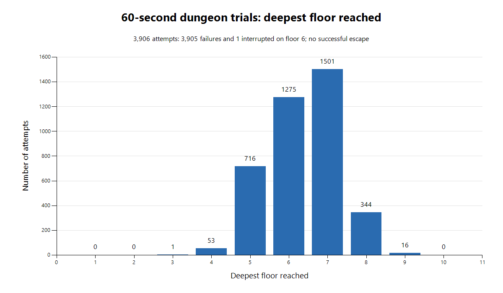

# Dungeon experiment results

- Trial timer: 60.0004785 seconds, excluding preparation, compilation and report generation.
- Outcome: no escape with a freed, living Ghost Dog before the deadline.
- Attempts started: 3,906.
- Failed attempts: 3,905 (3,900 deaths and 5 stalled runs).
- Interrupted at deadline: 1, on floor 6 after 184 turns.
- Deepest floor reached: 9.
- Policy: previous-rule-policy-v1.
- Seed sampling: math/rand stream seeded with 20261016, positive distinct 63-bit seeds; zero and the scripted seed 6 excluded.
- Verification: raw attempt count, distinct seeds, failure count and all histogram buckets agree with summary.json.

Preparation and compilation happened before one monotonic timer started. Every dungeon, decision, command and retry counted toward the same deadline. The timer ended with a 0.4785 ms overrun at a command boundary; no subsequent attempts ran.

The helper uses a fixed, deterministic decision policy with access to complete current floor state. It uses legal game commands without modifying gameplay state or inspecting future RNG. It does not simulate alternative moves, estimate action win probabilities, learn or call an LLM. This is Monte Carlo evaluation across sampled dungeons. These results describe this policy, whose limitations include no search for ordinary secret rooms, fixed equipment scores and choosing the first ghost gift.

## Deepest floor reached

All 3,906 started attempts are included; floor 6 includes the interrupted attempt.

| Floor | Attempts |
| --- | ---: |
| 1 | 0 |
| 2 | 0 |
| 3 | 1 |
| 4 | 53 |
| 5 | 716 |
| 6 | 1,275 |
| 7 | 1,501 |
| 8 | 344 |
| 9 | 16 |
| 10 | 0 |



Raw data: [attempts.jsonl](attempts.jsonl), [summary.json](summary.json), [histogram.csv](histogram.csv).
The run preserves its exact helper and runner, plus [manifest.json](manifest.json) with production source hashes and Go version.

The reusable version lives in [montecarlo/](../../../montecarlo/README.md). From the repository root:

```powershell
./montecarlo/run.ps1 -Seconds 60 -SamplingSeed 20261016
```

The full native Windows regression suite, go vet ./..., game build, overlay helper build/vet, experiment opt-in guard and git diff --check passed after adding the reusable helper. Go package discovery still includes only src and tests; normal suites do not discover the experiment template. Production gameplay files were not changed.

